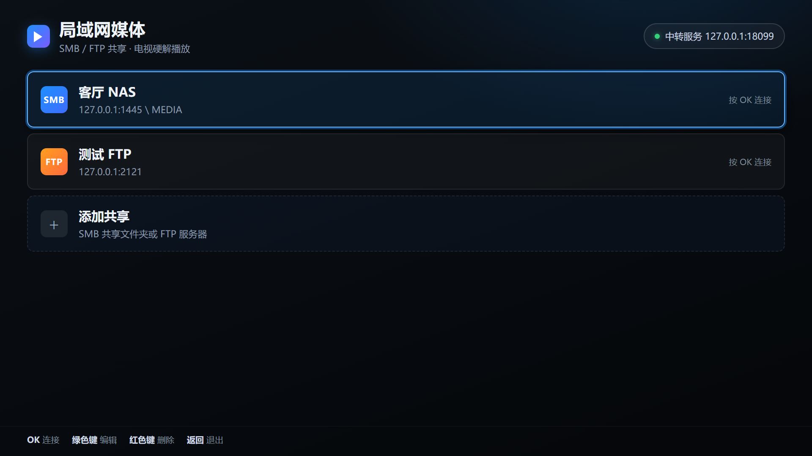
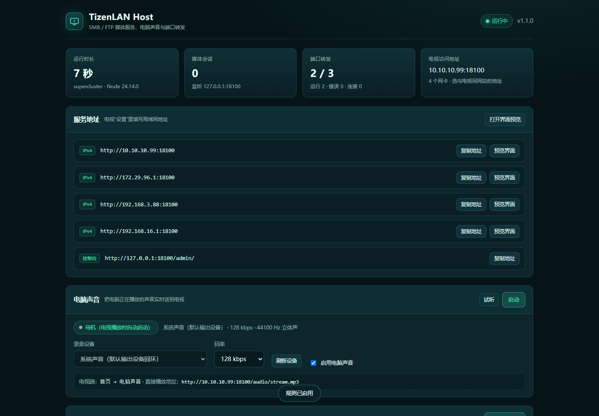
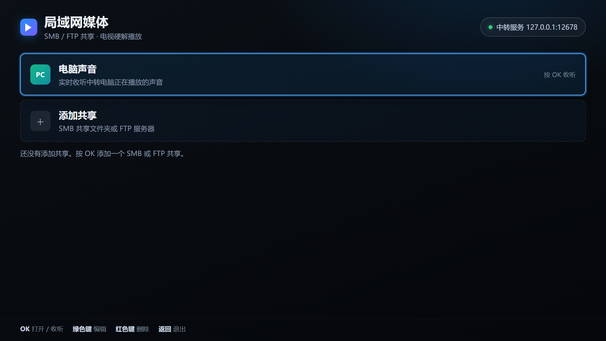
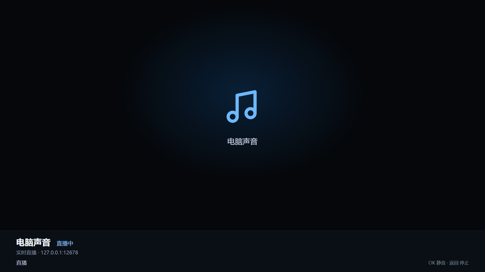
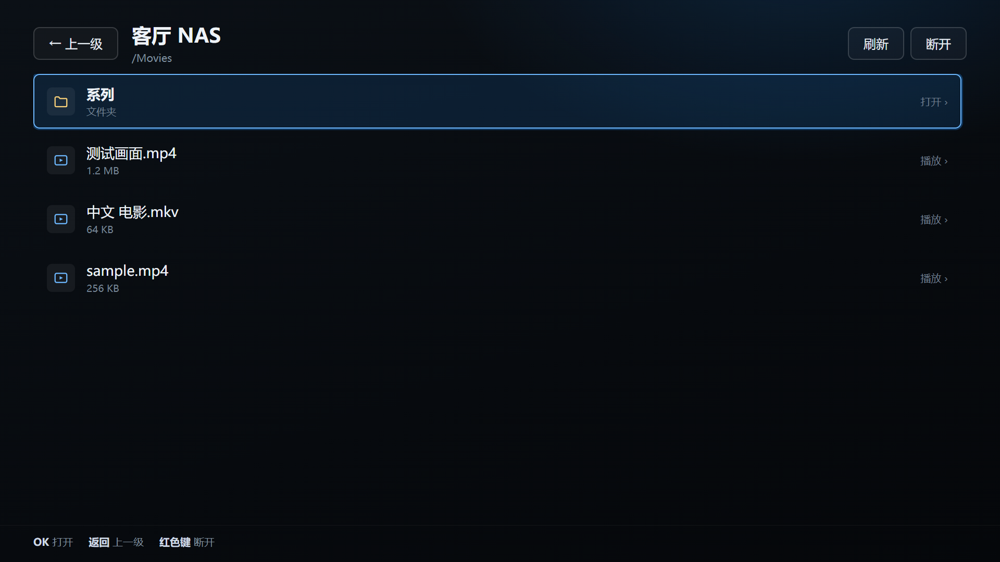
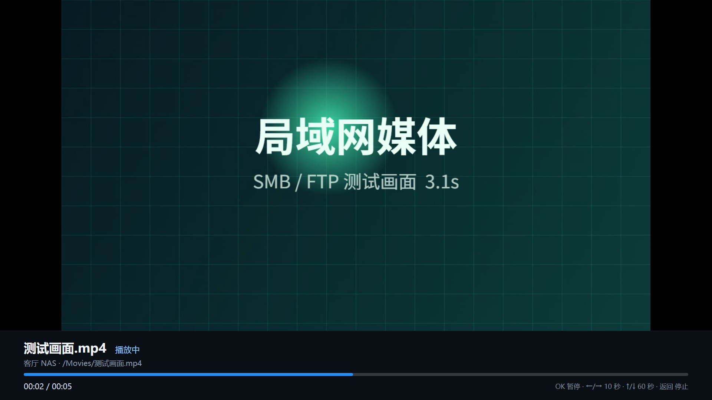
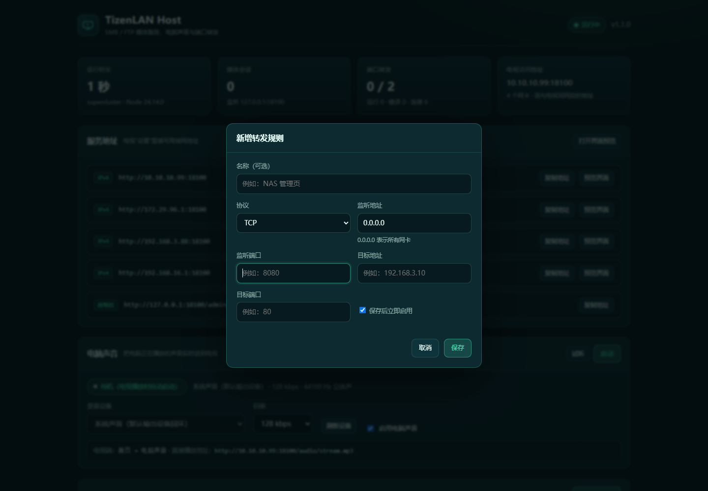

# 局域网媒体（Tizen TV）+ TizenLAN Host

在 2015 款三星 Tizen 电视上浏览并播放局域网 **SMB / FTP** 共享的视频、音乐和图片。视频交给电视自带的解码器（AVPlay / 硬件解码）播放，不是网页软解。

配套的 `host/` 程序同时提供 **TCP / UDP 端口转发**、**电脑系统声音实时转发** 和 **本地控制台**，一个程序解决电视访问共享、局域网端口映射和电脑声音上电视三类需求。host 可以打包成免 Node 的单文件 `TizenLANHost.exe`，双击即可运行。



## 为什么需要 host 服务

这台电视（UA55JU5920，Tizen 2.3）的 Web 应用没有原始 socket，也不支持 `smb://` / `ftp://`。项目因此拆成两部分：

```
电视应用 (tv-app)                     局域网电脑 / NAS (host)
┌──────────────────────┐   HTTP     ┌────────────────────────────────┐
│ 遥控器界面            │ ─────────▶ │ TizenLAN Host (Node.js)        │
│ 浏览目录 / 输入账号   │  Range     │  SMB2/3 (NTLMv2) / FTP / FTPS   │
│ AVPlay 硬解播放视频   │ ◀───────── │  文件 → HTTP 流（支持拖动进度）  │
│ 电脑声音直播          │ ◀───────── │  ffmpeg 采集系统声音 → MP3 流   │
└──────────────────────┘            │  TCP / UDP 端口转发             │
                                    │  本地控制台 /admin/             │
                                    └────────────────────────────────┘
```

- 密码只提交给 host，电视只拿到一个随机会话 ID（SID）；密码不会写进电视存储。
- host 用 HTTP Range 响应拖动进度，AVPlay 只负责解码和显示，1080p H.264 等格式由电视硬解。
- 电脑上的 host 必须保持运行，电视关闭后会话自动过期。
- 端口转发走独立的监听端口，与媒体服务互不影响。
- 电脑声音由 host 用 WASAPI 回环采集默认扬声器的声音（DirectShow 采集器作为回退），再交给 ffmpeg 编码成 MP3 推到电视；电视端用 HTML5 Audio 播放，可在首页直接进入。

## 目录

| 路径 | 说明 |
| --- | --- |
| `tv-app/` | Tizen Web 应用（ES5，兼容 Tizen 2.3） |
| `host/` | Node.js 统一服务：SMB/FTP 媒体代理 + 电脑声音直播 + TCP/UDP 转发 + 控制台，默认端口 8099 |
| `host/setup.ps1` | 安装依赖、防火墙、登录/开机自启或 NSSM 服务 |
| `host/uninstall.ps1` | 移除自启/服务/防火墙规则，可选清除数据 |
| `dist/TizenLANHost.exe` | 免 Node 的独立 host（内置运行时、ffmpeg、WASAPI 采集器） |
| `tools/build-tv.ps1` | 打包 `.wgt`，可顺带安装到电视 |
| `tools/make-icon.js` | 生成应用图标 |
| `docs/` | 构建、电视设置、host 部署文档 |
| `docs/screenshots/` | 界面与控制台截图（由脚本生成） |

## 快速开始

### 1. 启动 host（电脑 / NAS）

不想安装 Node.js 时，直接使用单文件 `dist\TizenLANHost.exe`（内置 Node 运行时、ffmpeg 和 WASAPI 采集器）：

1. 双击运行，或在命令行执行 `TizenLANHost.exe`（可加 `--port 9000` 临时换端口）。
2. 首次运行会把内部资源解压到 `%LOCALAPPDATA%\TizenLANHost\runtime`；`config.json` 和 `logs\` 默认在 exe 旁边，目录不可写时改放 `%LOCALAPPDATA%\TizenLANHost`。
3. 控制台地址、电视访问地址和电脑声音与源码方式完全一致，下面列出的功能都可用。
4. 自己构建：`cd host; npm install; npm run build:exe`，产物同样是 `dist\TizenLANHost.exe`。

> exe 没有代码签名，首次运行时 Windows SmartScreen 或杀毒软件可能提示，选择“仍要运行 / 允许”即可。

源码方式需要 Node.js 18 或更高版本。Windows 上推荐先跑安装脚本：

```powershell
cd D:\TIzenLAN\host
powershell -ExecutionPolicy Bypass -File setup.ps1
```

脚本会检查 Node、生成 `config.json`、安装依赖，并注册登录自启（可选防火墙、开机任务、NSSM 服务，见 [docs/HOST.md](docs/HOST.md)）。之后双击 `start-host.cmd` 即可启动；也可以手动：

```powershell
cd D:\TIzenLAN\host
npm install
npm start
```

启动后终端会打印本机与局域网地址，例如：

```
本机控制台: http://127.0.0.1:8099/admin/
电视访问:  http://192.168.3.88:8099
界面预览:  http://127.0.0.1:8099/app/
转发规则:  2 条（运行中 2）
```

- 电视应用里填 `192.168.3.88:8099`（只填 IP 时自动补 `http://` 和 `:8099`）。
- 电脑浏览器打开 `http://127.0.0.1:8099/admin/` 管理端口转发、电脑声音，查看日志；打开 `/app/` 可以先试用电视界面。
- 控制台默认只允许本机访问，需要局域网访问时把 `config.json` 的 `adminAllowLan` 设为 `true`。
- 电脑声音默认用 WASAPI 回环采集默认扬声器，不需要启用“立体声混音”；但 host 必须运行在当前登录的桌面会话里，远程桌面会话或系统服务（session 0）采集不到声卡。



### 2. 打包电视应用

项目复用 `D:\TizenRD` 已安装的 Tizen CLI SDK 和 `TizenRDTest` 测试证书：

```powershell
cd D:\TIzenLAN
powershell -ExecutionPolicy Bypass -File tools\build-tv.ps1
```

产物为 `dist\局域网媒体.wgt`。电视已开启开发者模式并 `sdb connect` 成功后，可以一条命令打包并安装：

```powershell
powershell -ExecutionPolicy Bypass -File tools\build-tv.ps1 -InstallTarget 192.168.3.83:26101
```

> 这台 2015 电视只接受 `TizenRDTest`（普通 Tizen 测试证书）签名的包；`TizenRD`（三星证书）签名的包会报 `PKGMGR_ERROR`。详见 [docs/TIZEN-BUILD.md](docs/TIZEN-BUILD.md)。

### 3. 在电视上使用

1. 打开“局域网媒体”，先设置 host 地址（只填 `192.168.3.88` 时默认使用 `http://IP:8099`）。
2. “添加共享”：SMB 填服务器、共享名（如 `MEDIA`）、用户名、域（工作组通常 `WORKGROUP`）；FTP 填服务器和端口。
3. 选择共享 → 输入密码 → 浏览目录。
4. 视频按 OK 播放；←/→ 快退/快进 10 秒，↑/↓ 60 秒，OK 暂停/继续，返回退出播放。文件很多时用频道 +/− 翻页，列表会跟随选中项滚动。
5. 首页最上方的“电脑声音”按 OK 即可实时收听电脑正在播放的声音；OK 静音，返回停止。
6. 图片按 OK 打开，←/→ 切换；返回键关闭。

遥控器：绿色键编辑共享，红色键删除共享，返回键逐级返回。

## 端口转发

在控制台“转发”卡片里新增规则：选择 `TCP` 或 `UDP`，填本机监听端口和目标 IP:端口，保存后立即生效并写入 `config.json`。

| 项目 | 说明 |
| --- | --- |
| 方向 | `本机监听端口 → 局域网目标 IP:端口` |
| 协议 | TCP、UDP 各建规则 |
| 并发 | 每条 TCP 规则最多 64 个连接；UDP 按客户端维护会话（空闲 60 秒回收） |
| 校验 | 端口冲突、占用媒体端口、目标指回自己都会被拒绝，并提示原因 |
| 防火墙 | 每条规则需要单独放行监听端口；`setup.ps1` 只放行媒体端口 |

## 电脑声音

把电脑正在播放的声音实时送到电视，电视端不需要额外硬件。控制台的“电脑声音”面板可以查看采集方式、选择码率（32–320 kbps）、开关功能，并一键试听。

| 项目 | 说明 |
| --- | --- |
| 采集 | 默认 WASAPI 回环：`bin/wasapi-loopback.exe` 采集默认扬声器，PCM 交给 ffmpeg；没有该采集器时回退 DirectShow（可配置 `audio.device` 选择“立体声混音”等设备） |
| 输出 | MP3 流：`http://<电脑IP>:8099/audio/stream.mp3`，电视用 HTML5 Audio 播放；没有声音时也持续输出静音，避免电视端断流 |
| 启动 | 电视首次连接时自动启动采集；无人收听 15 秒后自动停止（手动启动的不会自动停） |
| 并发 | 最多 8 台电视同时收听；落后超过 256 KB 的慢连接会被断开 |
| 依赖 | `@ffmpeg-installer/ffmpeg`；WASAPI 采集器由 `setup.ps1` 用系统自带 csc 编译，也可用 `audio.ffmpegPath` 指定本机 ffmpeg |
| 前提 | Windows + 已登录的桌面会话，默认扬声器有声音输出；新版 Realtek 的“立体声混音”只有 WASAPI 端点，DirectShow 可能看不到，因此默认走 WASAPI 回环 |

> 远程桌面（RDP）会话和 NSSM/开机任务（session 0）看不到本机声卡：控制台“最近错误”会提示没有找到录音设备，电视端提示无法播放。请在电脑本机登录后运行 host，或改用登录自启方式。WASAPI 采集的是“默认输出设备”的混音；切换默认扬声器后采集会停止，重新点击播放即可。





## 界面

| 浏览文件 | 播放（电视解码） |
| --- | --- |
|  |  |

| host 控制台 | 转发规则表单 |
| --- | --- |
|  |  |

更多截图见 [docs/screenshots](docs/screenshots)。

## 支持范围

| 项目 | 说明 |
| --- | --- |
| SMB | SMB 2 / 2.1 / 3，NTLMv2；**不支持 SMB1**（很老的 NAS 需要先开启 SMB2） |
| FTP | 普通 FTP、显式 FTPS；支持 UTF-8 / GBK / GB18030 / Big5 文件名编码 |
| 转发 | 任意 TCP / UDP 端口，多条规则，热生效 |
| 媒体类型 | 视频、音频、图片；字幕文件会列出但当前不能挂载 |
| 视频解码 | 由电视 AVPlay 决定。H.264 MP4、1080p 通常没问题；HEVC/4K 取决于具体机型 |
| 音频 | 走 HTML5 Audio（Tizen 2.3 支持 MP3/AAC/M4A 等） |
| 电脑声音 | WASAPI 回环采集默认扬声器 → ffmpeg 编码 MP3 实时流，电视端 HTML5 Audio 直播 |
| 图片 | JPG / PNG / GIF / BMP / WebP（取决于电视浏览器） |

## 已知限制

- 电脑或 NAS 上的 host 必须一直运行；电视应用本身不能直接访问 SMB/FTP。
- 外挂字幕暂不支持：AVPlay 的网络字幕需要本地文件绝对路径，无法直接使用共享里的 `.srt`。后续可在 host 里把字幕转成 WebVTT 叠加显示。
- 应用重启后需要重新输入密码（密码只保存在内存，这是有意的安全设计）。
- 同一时间电视上只维持一个共享会话；切换共享会自动断开上一个。
- `.mkv`、`.avi` 等只是允许被选中，能否播放取决于电视解码器；播不了时界面会提示并返回列表。
- 控制台默认只允许本机访问，也没有登录口令；开启 `adminAllowLan` 前请确认网络可信。
- 电脑声音依赖桌面会话：host 在远程桌面或服务（session 0）里运行时无法采集，只能听共享里的音频文件；WASAPI 只采集默认输出设备，切换扬声器后需要重新连接。

## 开发与测试

```powershell
cd host
npm test              # 媒体端到端测试：FTP + SMB（含 SMB 需 Python + impacket，缺少时自动跳过 SMB 部分）
npm run test:forward  # 25 项转发测试：TCP/UDP 回环、校验、持久化、热重载
npm run test:audio    # 26 项电脑声音测试：设备解析、WASAPI 管线、MP3 流、控制台音频 API（合成音源，不需要声卡）
npm run test:all      # 以上三组
npm run test:ui       # 无头 Chrome：控制台表单操作 + 电视端电脑声音入口与直播播放
npm run preview       # 启动 FTP 测试服务器 + host，浏览器打开 /app/ 预览
npm run shots         # 无头 Chrome 生成电视界面截图
npm run shots:admin   # 无头 Chrome 生成控制台截图并执行一次表单操作
npm run build:exe     # 打包免 Node 的单文件 dist\TizenLANHost.exe
```

`npm test` 的 SMB 测试端口默认 1445，被系统或 Hyper-V 保留时可换一个：

```powershell
$env:TIZENLAN_SMB_TEST_PORT=4450; npm test
```

`npm run shots` 还需要 SMB 测试服务在 1445 端口运行，并安装 Windows 版 Chrome：

```powershell
cd host\test
python run_smbserver.py 1445 data demo demo123
```

SMB 测试服务使用 Python `impacket`；如果杀毒软件删除了 `impacket/dcerpc/v5/nrpc.py`，`test/smbserver_stub.py` 会注入一个占位模块，测试仍可运行。测试数据在 `host/test/data`，每次 `npm test` 会重新生成。

## 文档

- [TizenLAN Host 部署、配置与转发](docs/HOST.md)
- [电视应用构建、安装与排错](docs/TIZEN-BUILD.md)
- [电视端设置与使用](docs/TV-SETUP.md)

## 许可证

本项目代码可自由使用。依赖库许可证见 `host/node_modules` 及各包声明。
