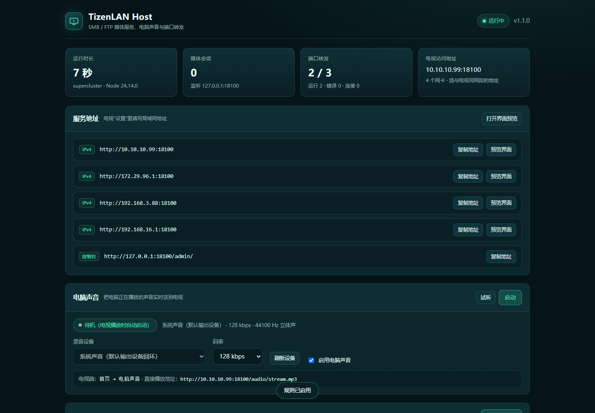

# TizenLAN Host（统一 host 服务）

`host/` 是一个纯 Node.js 服务，把原来“中转服务”的能力全部集中在一个程序里：

| 功能 | 说明 |
| --- | --- |
| 媒体代理 | 对电视暴露 HTTP 接口，对内连接 SMB / FTP，把共享文件转成可拖动进度的 HTTP 流 |
| 电脑声音 | WASAPI 回环采集电脑默认扬声器，ffmpeg 编码 MP3 实时流，电视端首页直接收听 |
| 电视界面预览 | 把 `tv-app/` 托管在 `/app/`，方便在电脑上调试 |
| TCP / UDP 端口转发 | 多条规则，`本机端口 → 局域网目标 IP:端口`，TCP、UDP 均支持 |
| 本地控制台 | `http://127.0.0.1:<端口>/admin/`：启停转发、增删改规则、电脑声音开关、查看流量与日志 |
| 服务 / 自启 | 提供 `setup.ps1` 注册登录自启、开机自启或 NSSM 服务 |

电视应用本身没有改动，仍然只访问媒体 HTTP 接口。



## 运行要求

| 项目 | 要求 |
| --- | --- |
| Node.js | 源码方式需要 18 或更高（开发验证用 Node 24）；独立 exe 不需要 |
| 网络 | 与电视、NAS / 共享主机在同一局域网 |
| 平台 | Windows、Linux、macOS 均可；NAS 可用 Docker 或 Node 直接跑（电脑声音仅 Windows 可用）；独立 exe 为 Windows x64 |
| 端口 | 默认 TCP 8099（电视访问 + 控制台）；每条转发规则另有自己的监听端口 |

依赖全部是纯 JS，不需要编译工具。SMB 使用 `v9u-smb2`（NTLMv2），FTP 使用 `basic-ftp`。电脑声音额外使用可选依赖 `@ffmpeg-installer/ffmpeg`（随 `npm install` 自动安装）；WASAPI 采集器源码在 `tools/wasapi-loopback.cs`，`setup.ps1` 会用系统自带的 csc.exe 编译到 `bin/wasapi-loopback.exe`（host 首次启动时发现缺失也会自动编译）。也可以在 `audio.ffmpegPath` 里指定系统中的 `ffmpeg.exe`。

Windows 上还可以直接使用单文件 `dist\TizenLANHost.exe`：内置 Node 运行时、ffmpeg 和 WASAPI 采集器，不需要 Node/npm，也不需要 `.cmd` / `.vbs` / `.ps1` 脚本。

## 安装与启动

### 独立 exe（免 Node）

```powershell
D:\TIzenLAN\dist\TizenLANHost.exe                    # 默认 8099
D:\TIzenLAN\dist\TizenLANHost.exe --port 9000        # 临时换端口
D:\TIzenLAN\dist\TizenLANHost.exe --config D:\data\tizenlan.json
```

- 首次运行会把 `admin.html`、`tv-app/`、`bin\ffmpeg.exe`、`bin\wasapi-loopback.exe` 解压到 `%LOCALAPPDATA%\TizenLANHost\runtime`；之后直接复用，exe 更新后按构建号自动重新解压。
- `config.json` 和 `logs\` 默认放在 exe 所在目录；目录不可写（例如放到 `Program Files`）时自动改用 `%LOCALAPPDATA%\TizenLANHost`。`--config` 指定的配置文件优先，日志仍跟随配置目录。
- 环境变量：`TIZENLAN_CONFIG_DIR` 指定配置/日志目录，`TIZENLAN_DATA_DIR` 指定运行时解压目录。
- 转发规则、控制台、电脑声音与源码方式完全一致；防火墙仍需放行 8099 和每条转发端口。
- 构建：`cd host; npm install; npm run build:exe`。构建先用 esbuild 打包代码，再用 Node SEA 把运行时与资源注入 `node.exe`，产物约 110 MB。
- exe 没有代码签名，SmartScreen 可能拦截；选择“更多信息 → 仍要运行”。

### 源码方式（Node.js）

Windows 上推荐先跑一次安装脚本（检查 Node、生成配置、安装依赖，可选防火墙/自启/服务）：

```powershell
cd D:\TIzenLAN\host
powershell -ExecutionPolicy Bypass -File setup.ps1
```

之后双击 `start-host.cmd` 启动；`start-host-hidden.vbs` 是不弹窗的版本（计划任务用的就是它）。

手动方式：

```powershell
cd D:\TIzenLAN\host
npm install
npm start
```

启动后会打印可用地址：

```
TizenLAN Host 已启动
  本机控制台: http://127.0.0.1:8099/admin/
  电视访问:  http://192.168.3.88:8099
  界面预览:  http://127.0.0.1:8099/app/
  端口转发:  2 条（运行中 2）
  电脑声音:  http://192.168.3.88:8099/audio/stream.mp3
```

在电视应用里填 `192.168.3.88:8099`（只填 IP 时自动补 `http://` 和 `:8099`）。

### 常用命令

```powershell
npm start                          # 默认 config.json
node server.js --port 9000         # 临时换端口
node server.js --host 0.0.0.0      # 临时换监听地址
node server.js --config my.json    # 指定配置文件
$env:PORT=9000; npm start          # 用环境变量换端口
```

## 配置

源码方式为 `host/config.json`；独立 exe 默认在 exe 旁边（目录不可写时为 `%LOCALAPPDATA%\TizenLANHost\config.json`）。首次启动时自动生成：

```json
{
  "listenHost": "0.0.0.0",
  "listenPort": 8099,
  "sessionTtlMinutes": 30,
  "maxSessions": 16,
  "loginAttemptsPerMinute": 20,
  "serveApp": true,
  "adminAllowLan": false,
  "logFile": "logs/host.log",
  "audio": {
    "enabled": true,
    "device": "",
    "bitrateKbps": 128
  },
  "forwards": [
    {
      "id": "f3a1c2",
      "name": "NAS 管理页",
      "protocol": "tcp",
      "listenHost": "0.0.0.0",
      "listenPort": 5000,
      "targetHost": "192.168.3.10",
      "targetPort": 5000,
      "enabled": true
    }
  ]
}
```

| 字段 | 说明 |
| --- | --- |
| `listenHost` | `0.0.0.0` 允许电视访问；只在本机预览可改成 `127.0.0.1` |
| `listenPort` | HTTP 端口（媒体接口 + 控制台），默认 8099 |
| `sessionTtlMinutes` | 会话空闲过期时间，最小 5 分钟 |
| `maxSessions` | 同时存在的共享会话上限（1–64） |
| `loginAttemptsPerMinute` | 每个客户端 IP 每分钟的登录尝试上限 |
| `serveApp` | 是否托管 `tv-app` 预览页；关掉后 `/app/` 返回 404 |
| `adminAllowLan` | 默认 `false`：控制台只允许本机访问；局域网访问返回 403 |
| `logFile` | 日志路径，相对路径以 `host/` 为基准，超过 5MB 自动轮转为 `.1` |
| `audio.enabled` | 是否允许电视收听电脑声音；关闭后音频接口返回 `audio_disabled` |
| `audio.device` | 仅用于 DirectShow 回退：录音设备名。留空时默认用 WASAPI 回环采集默认扬声器；填了设备名则改用 DirectShow（如 `立体声混音`） |
| `audio.bitrateKbps` | MP3 码率，32–320，默认 128 |
| `audio.ffmpegPath` | 可选，自定义 ffmpeg 可执行文件路径（默认用 `@ffmpeg-installer/ffmpeg`） |
| `forwards` | 端口转发规则数组，见下一节；控制台修改后会原子写回此文件 |

日志只记录协议、主机、端口、SID 前 8 位、转发规则 ID 和错误码，**不会记录密码**。

## 端口转发

每条规则把本机的一个监听端口转发到局域网内的目标地址，TCP、UDP 都支持。

| 字段 | 说明 |
| --- | --- |
| `id` | 规则 ID，不填时自动生成 |
| `name` | 显示名称，仅用于控制台和日志 |
| `protocol` | `tcp` 或 `udp` |
| `listenHost` | 本机监听地址，默认 `0.0.0.0`（局域网可访问）；改成 `127.0.0.1` 只转发本机流量 |
| `listenPort` | 本机监听端口（1–65535，不能与媒体端口相同） |
| `targetHost` | 目标地址，可以是 IP 或主机名 |
| `targetPort` | 目标端口（1–65535） |
| `enabled` | 是否启用；停用后端口释放但规则保留 |

限制与保护：

- 同一协议下监听端口不能重复；`0.0.0.0` 与具体地址的同一端口也视为冲突。
- 目标不能指回自己（如监听 5300 又转发到 `127.0.0.1:5300`），避免环路。
- 每条 TCP 规则最多 64 个并发连接，连接目标超时 10 秒。
- UDP 按客户端地址维护会话：空闲 60 秒回收，每条规则最多 512 个会话。
- 规则校验失败时返回 400，控制台会显示具体原因；修改失败会回滚配置文件。
- 转发端口需要自己在防火墙上放行（`setup.ps1` 只放行媒体端口）。

控制台里可以随时启停单条规则、编辑、删除；改动立即生效并保存到 `config.json`，重启后自动恢复。

## 电脑声音

把电脑正在播放的声音实时送到电视：电视首页第一项“电脑声音”按 OK 即可收听，无需在电视端做任何配置（沿用已设置的中转服务地址）。

| 项目 | 说明 |
| --- | --- |
| 采集 | 默认 WASAPI 回环：`bin/wasapi-loopback.exe` 采集默认输出设备的混音，PCM 经 ffmpeg 编码；采集器不可用或配置了 `audio.device` 时回退 ffmpeg `-f dshow`（可选“立体声混音”、麦克风或虚拟声卡） |
| 编码 | MP3，44.1 kHz 立体声，码率 32–320 kbps（默认 128） |
| 传输 | `GET /audio/stream.mp3` 持续输出的 chunked 流；电视用 HTML5 Audio 播放，直播模式隐藏进度条 |
| 生命周期 | 电视首次连接时自动启动；最后一个听众断开 15 秒后自动停止；控制台“启动”的采集会一直运行到手动停止 |
| 缓冲 | 启动前缓存 64 KB 便于秒开；写入积压超过 256 KB 的慢连接会被断开，最多 8 个听众 |
| 电视操作 | OK 静音 / 取消静音，返回停止；实时流不支持快进快退 |

前提条件：

1. Windows 10/11，host 运行在登录后的桌面会话（双击 `start-host.cmd`，或默认的登录自启任务）；远程桌面（RDP）会话和 NSSM/`-StartupTask` 的 session 0 看不到本机声卡，接口会返回 `audio_no_device`。
2. 默认扬声器正在播放声音。WASAPI 回环直接采集默认输出设备，**不需要启用“立体声混音”**；系统静音时输出的是静音流，不会断流。
3. 没有 WASAPI 采集器（例如缺少 .NET Framework 4 的 csc.exe）时回退 DirectShow，此时需要“立体声混音”或其它录音设备，可在控制台下拉框里选择；新版 Realtek 的“立体声混音”只有 WASAPI 端点，DirectShow 枚举不到属于正常现象。

控制台“电脑声音”面板可以查看运行状态和采集方式、修改码率、启停采集和点“试听”验证；WASAPI 模式下录音设备固定为“系统声音（默认输出设备）”，修改会立即写入 `config.json`。

切换默认扬声器后 WASAPI 采集会停止（采集器检测到设备变化后退出），重新在电视端或控制台点一次播放即可。

> `bin/wasapi-loopback.exe` 是内部管道程序：stdout 输出的是 WAV 二进制流（开头是 `RIFF...WAVEfmt ...data`），stderr 才是 `device=` / `format=` 诊断信息。直接双击或在终端运行会看到“乱码”，这是二进制被当作文本显示，属于正常现象；host 会把它接到 ffmpeg 编码成 MP3。

## 控制台

浏览器打开 `http://127.0.0.1:<端口>/admin/`：

- 概览：运行时长、会话数、转发规则状态、本机可用地址（选与电视同网段的那个）。
- 电脑声音：状态、采集方式（WASAPI 回环 / DirectShow）、连接数、录音设备、码率、累计流量、最近错误；可启动/停止、切换设备、改码率、试听。
- 转发：表格展示协议、名称、监听 → 目标、状态、连接数、上下行字节；支持新增 / 编辑 / 启停 / 删除。
- 日志：自动滚动显示日志尾部，可手动刷新。
- 控制台默认只允许本机访问（`adminAllowLan: false`）；开启局域网访问前请确认网络可信。
- 页面带 CSP、`X-Frame-Options: DENY`，不返回 CORS 头；所有修改接口要求 `Content-Type: application/json`。

### 管理 API

| 方法 | 路径 | 说明 |
| --- | --- | --- |
| GET | `/admin/api/status` | 版本、运行时长、地址、会话数、转发统计、音频状态 |
| GET | `/admin/api/config` | 当前生效的配置（含配置文件路径） |
| GET | `/admin/api/audio/status` | 电脑声音状态：运行、连接数、设备、码率、错误 |
| GET | `/admin/api/audio/devices` | 返回采集方式 `mode`（`wasapi` / `dshow`）；DirectShow 模式下附带设备列表与 `configured` / `selected` |
| POST | `/admin/api/audio/start` | 手动启动采集，可带 JSON `{device, bitrateKbps}` |
| POST | `/admin/api/audio/stop` | 停止采集并断开所有听众 |
| POST / PUT | `/admin/api/audio/config` | 修改 `enabled` / `device` / `bitrateKbps` 并持久化 |
| GET | `/admin/api/forwards` | 规则列表（含状态、连接数、字节统计） |
| POST | `/admin/api/forwards` | 新增规则（JSON，字段同上表） |
| PUT / POST | `/admin/api/forwards/:id` | 修改规则 |
| DELETE | `/admin/api/forwards/:id` | 删除规则 |
| GET | `/admin/api/logs?lines=200` | 日志尾部（最多 1000 行） |
| POST | `/admin/api/reload` | 重新读取 `config.json` 并应用转发规则 |

## Windows 部署

### 独立 exe 自启

任务计划程序 → 创建任务 → 触发器“登录时” → 操作直接指向 exe：

- 程序：`D:\TIzenLAN\dist\TizenLANHost.exe`
- 起始于：`D:\TIzenLAN\dist`

不需要 wscript/vbs。exe 放在不可写目录时，配置和日志会自动落到 `%LOCALAPPDATA%\TizenLANHost`；电脑声音仍要求运行在桌面会话。

### setup.ps1 参数

```powershell
powershell -ExecutionPolicy Bypass -File setup.ps1                       # 依赖 + 防火墙 + 登录自启
powershell -ExecutionPolicy Bypass -File setup.ps1 -Port 9000            # 指定媒体端口（写入新配置）
powershell -ExecutionPolicy Bypass -File setup.ps1 -NoFirewall -NoAutostart
powershell -ExecutionPolicy Bypass -File setup.ps1 -StartupTask          # 管理员：开机启动（SYSTEM）
powershell -ExecutionPolicy Bypass -File setup.ps1 -Service -NssmPath C:\tools\nssm.exe
```

- 默认注册登录时自启的计划任务 `TizenLANHost`（通过 `start-host-hidden.vbs`，无窗口）。
- `-StartupTask` 注册开机任务 `TizenLANHostBoot`（SYSTEM），适合无人值守的机器。
- `-Service` 用 NSSM 安装 `TizenLANHost` 服务（自动启动、日志输出到 `logs/service-*.log`）。
- 只放行媒体端口的入站 TCP；每条转发规则需要单独放行。
- 电脑声音需要桌面会话：`-StartupTask`（SYSTEM 开机任务）和 `-Service`（NSSM 服务）在 session 0 运行，采集不到声卡；需要电脑声音时请用默认的登录自启任务。
- 卸载：`powershell -ExecutionPolicy Bypass -File uninstall.ps1`；加 `-Purge` 同时删除配置和日志。

### 任务计划程序（手动）

1. 打开“任务计划程序” → 创建任务。
2. 触发器：登录时（或开机时）。
3. 操作：启动程序 `C:\Windows\System32\wscript.exe`，参数 `start-host-hidden.vbs` 的完整路径，起始于 `D:\TIzenLAN\host`。
4. 勾选“不管用户是否登录都要运行”时，请确认该账号能访问网络共享。

### NSSM（手动）

```powershell
nssm install TizenLANHost "C:\Program Files\nodejs\node.exe" "D:\TIzenLAN\host\server.js"
nssm set TizenLANHost AppDirectory "D:\TIzenLAN\host"
nssm start TizenLANHost
```

## NAS / Docker 部署

把整个 `host/` 目录（含 `package.json`、`src/`、`config.json`）放到 NAS，然后用 Node 20 镜像运行：

```yaml
services:
  tizenlan-host:
    image: node:20-alpine
    container_name: tizenlan-host
    working_dir: /app
    command: sh -c "npm ci --omit=dev && node server.js"
    volumes:
      - ./host:/app
    ports:
      - "8099:8099"
      - "5000:5000"      # 每条转发规则按需映射
    restart: unless-stopped
```

- 容器需要能出站访问 SMB（TCP 445）和 FTP（TCP 21 及被动端口段）。
- 电脑声音依赖 Windows WASAPI 回环 / DirectShow 声卡，Docker/NAS/Linux 上不会启用；控制台仍可正常管理转发。
- `serveApp` 使用的 `tv-app` 路径是 `../tv-app`，在 NAS 上如果不放电视源码，可把 `serveApp` 设为 `false`；电视应用不依赖这个预览页。
- 控制台默认只允许本机访问；在容器里调试可把 `adminAllowLan` 设为 `true`（确保网络可信）。
- 转发规则的监听端口要在 `ports` 里映射出去，否则局域网访问不到。

## 防火墙

Windows 防火墙放行入站 TCP 8099（`setup.ps1` 默认只对专用网络开放）。共享主机一侧：

- SMB：TCP 445。
- FTP：TCP 21，以及服务器配置的被动端口段（如 50000–50100）。
- 每条转发规则：放行对应的监听端口，例如：

```powershell
New-NetFirewallRule -DisplayName "TizenLAN forward 5000" -Direction Inbound `
  -Action Allow -Protocol TCP -LocalPort 5000 -Profile Private
```

UDP 规则把 `-Protocol TCP` 改成 `UDP`。

## 媒体 HTTP 接口

电视应用使用的接口（全部为局域网明文 HTTP，不含 TLS）：

| 方法 | 路径 | 说明 |
| --- | --- | --- |
| GET | `/api/health` | 返回 `{ok, name, version, uptime, sessions, forwards, audio}`；`audio` 含 `enabled/running/clients/mode` |
| POST | `/api/session` | 创建会话，JSON：`protocol`、`host`、`port`、`share`、`username`、`password`、`domain`、`secure`、`encoding`、`name` |
| GET | `/api/list?sid=…&path=…` | 列出目录，返回 `path`、`parent`、`entries[{name,path,dir,size,mtime,kind}]` |
| GET / HEAD | `/s/<sid>/<相对路径>` | 流式读取文件，支持 `Range`、`If-Range`、`HEAD` |
| GET / HEAD | `/audio/stream.mp3` | 电脑声音 MP3 实时流；关闭功能时返回 503 `audio_disabled` |
| DELETE | `/api/session?sid=…` | 关闭会话（也支持 `POST /api/session/close`） |
| GET | `/app/` | 电视界面预览页 |

会话 ID 是 24 字节随机数的 48 位十六进制串，不可枚举。会话过期或关闭后，`/s/` 与 `/api/list` 都返回 404。

## 协议细节

### SMB

- 支持 SMB 2 / 2.1 / 3，NTLMv2 认证。
- 必须填写共享名（如 `MEDIA`），不是磁盘路径。
- 域：工作组环境填 `WORKGROUP`；域环境填 AD 域名。留空时按工作组处理。
- 需要服务器开启 SMB2 或更高版本；SMB1-only 的老设备不支持。
- Node 24 的 OpenSSL 3 默认移除了 MD4 / DES-ECB，项目用 `js-md4` + `des.js` 在 `src/crypto-compat.js` 中补齐，并修正了 `v9u-smb2` 的 NTLMv2 编码问题（`src/smb2-compat.js`）。不需要 `--openssl-legacy-provider`。

### FTP

- 支持普通 FTP 和显式 FTPS（AUTH TLS）。
- 文件名编码：默认 UTF-8；中文乱码时在电视端切换为 GBK 或 GB18030。
- 使用被动模式；FTP 服务器的被动端口段要允许 host 访问。
- 匿名登录：密码留空。

## 排错

| 现象 | 处理 |
| --- | --- |
| 电视提示“无法连接中转服务” | 确认 host 在跑、电视能 ping 通电脑、Windows 防火墙放行 8099；先在电脑浏览器打开 `http://<电脑IP>:8099/api/health` |
| 电脑浏览器能开、电视不能 | 电视填的是 `127.0.0.1` 或 `localhost`；必须填电脑的局域网 IP |
| 控制台打不开 / 403 | 默认只允许本机访问；从别的机器访问需把 `adminAllowLan` 设为 `true` 并重启 |
| 控制台修改提示 415 | 修改接口要求 `Content-Type: application/json` |
| 转发规则状态 `error` | 看控制台日志里的 `forward error`：端口被占用、目标不可达、地址写错 |
| 转发端口电视/手机连不上 | 防火墙没放行该端口，或规则的 `listenHost` 写成了 `127.0.0.1` |
| SMB `STATUS_LOGON_FAILURE` | 用户名/密码/域不对；工作组环境域填 `WORKGROUP`；确认共享名而不是路径 |
| SMB 连接超时 | 共享主机只开了 SMB1，或 445 被防火墙拦截 |
| FTP `530` | 账号密码错误；匿名登录请把密码留空 |
| FTP 能登录但列目录乱码 | 电视端把“文件名编码”改为 GBK / GB18030 |
| 视频黑屏但有声音 | 应用会提示“没有可播放的视频轨”时，是编码不被电视支持（如 HEVC/10bit/4K），换 H.264 1080p 文件测试；否则升级电视应用（1.2.0 起已修复 AVPlay 画面被网页背景遮住的问题） |
| 电脑声音提示“没有找到录音设备” | host 在远程桌面/服务（session 0）里运行，或既没有 WASAPI 采集器也没有 DirectShow 录音设备；在电脑本机登录运行 host，并确认 `host\bin\wasapi-loopback.exe` 存在（缺失且有 csc.exe 时会自动编译） |
| 控制台采集方式显示 DirectShow 且设备为空 | 新版 Realtek 的“立体声混音”只有 WASAPI 端点，DirectShow 枚举不到；把 `audio.device` 清空、确认 `bin\wasapi-loopback.exe` 存在即可回到 WASAPI 回环 |
| 切换默认扬声器后直播中断 | WASAPI 采集绑定默认输出设备，切换后采集器会退出；重新在电视端点“电脑声音”或控制台点“启动” |
| 电脑声音无声或频繁断流 | 电脑本身没有声音输出（系统静音时采集也是静音）；在控制台把码率降到 64–96 kbps；确认控制台状态里没有最近错误 |
| 电脑声音有延迟 | MP3 直播本身有 0.5–2 秒缓冲；码率越高、无线网络越差延迟越大 |
| 日志里出现 `client error` | 通常是电视端主动断开或网络抖动；不影响其他会话 |
| exe 双击后窗口闪退 | 看 exe 旁的 `logs\host.log`；端口 8099 被占用或运行时解压失败时会报错 |
| exe 首次启动较慢 | 首次要解压约 60 MB 的 ffmpeg，通常几秒完成；之后直接复用 |
| SmartScreen 阻止运行 exe | exe 未签名，点“更多信息 → 仍要运行” |
| 拷走 exe 后转发规则没了 | 配置在 exe 旁的 `config.json`，需要和 exe 一起复制 |

日志文件默认在 `host/logs/host.log`。

## 测试

```powershell
cd D:\TIzenLAN\host
npm test            # 媒体端到端测试（FTP + SMB；缺少 Python + impacket 时自动跳过 SMB 部分）
npm run test:forward # 25 项转发测试（TCP/UDP 回环、校验、持久化、热重载）
npm run test:audio   # 26 项电脑声音测试（合成音源，不需要声卡；WASAPI 采集器存在时校验默认模式）
npm run test:ui      # 无头 Chrome：控制台操作 + 电视端电脑声音入口与直播播放
npm run shots:admin  # 无头 Chrome 生成控制台截图并做一次表单操作
npm run build:exe    # 构建免 Node 的 dist\TizenLANHost.exe（Windows）
```

`npm test` 的 SMB 测试端口默认 1445；被系统或 Hyper-V 保留时可用 `$env:TIZENLAN_SMB_TEST_PORT=4450` 覆盖。

媒体测试需要 Python + impacket 的 SMB 测试服务（见 README）。转发测试、音频测试和 UI 测试是自包含的，会自行启动临时 host 和浏览器。
